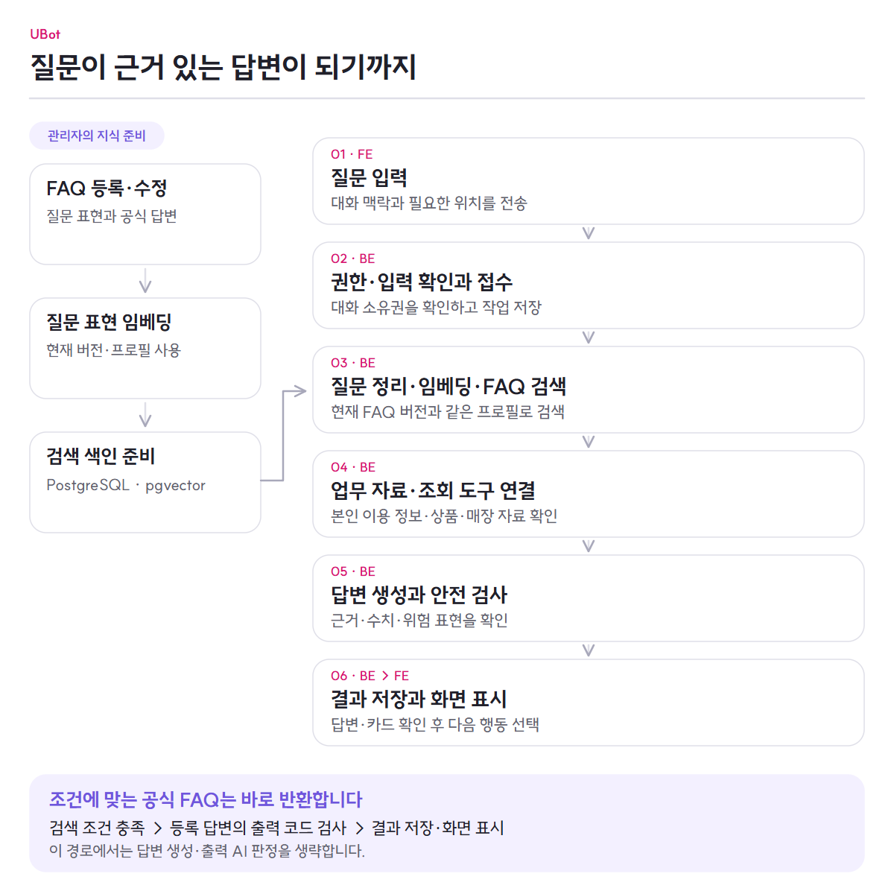

# 채팅과 RAG 전체 흐름

UBot의 채팅은 관리자가 준비한 FAQ와 현재 대화, 서버가 조회한 업무 자료를 연결합니다. 서버가 답변을 검사·저장하면 화면이 진행 상태와 결과를 보여 줍니다.

[전체 기능](../README.md) · [지식 개선](../features/knowledge-improvement.md) · [질문·답변 보호](../features/ai-safety.md) · [상담사 연결](../features/counselor-handoff.md)

<picture>
  <source media="(max-width: 767px)" srcset="../images/chat-flow-mobile.png">
  
</picture>

[그림 크게 보기](../images/chat-flow.png) · [모바일 그림](../images/chat-flow-mobile.png)

## 먼저 준비되는 FAQ 검색 인덱스

실시간 질문을 검색하려면 FAQ 원문만 저장돼 있어서는 안 됩니다. 관리자가 FAQ를 관리하는 흐름과 실제 질문을 처리하는 흐름이 다음 지점에서 만납니다.

1. 관리자가 FAQ와 카테고리, 처리 의도, 공식 답변, 검색에 사용할 질문 표현을 등록하거나 수정합니다.
2. Backend는 FAQ 버전과 활성 상태를 기록합니다. 수정 전 내용은 이력으로 남기고 현재 검색 대상과 구분합니다.
3. 현재 Embedding Profile에 맞는 모델이 각 질문 표현을 벡터로 바꿉니다.
4. Backend는 벡터에 FAQ 버전·프로필·벡터 종류를 함께 기록합니다.
5. PostgreSQL과 pgvector의 HNSW 인덱스가 현재 버전의 활성 질문 표현을 검색할 수 있게 합니다.
6. 모델이나 프로필이 바뀌면 기존 벡터를 같은 공간으로 간주하지 않습니다. 새 프로필로 다시 색인하고 준비되지 않은 벡터를 운영 지표로 확인합니다.

이 준비 과정 덕분에 채팅 요청은 “현재 FAQ의 현재 질문 표현”만 검색합니다. 삭제된 FAQ, 오래된 FAQ 버전, 다른 모델 공간에서 만든 벡터는 현재 검색 결과에 섞이지 않습니다.

상세 구현은 [FAQ·임베딩·백필](https://github.com/ureca-UBot/UBot-BE/blob/f782ec7c72cc2af0631570e3b3e0d0a260072a25/docs/features/faq-management.md)과 [지식 관리](https://github.com/ureca-UBot/UBot-BE/blob/f782ec7c72cc2af0631570e3b3e0d0a260072a25/docs/features/unanswered-improvement.md)에서 확인합니다.

## 1. Frontend가 질문을 대화에 붙입니다

1. 사용자가 통합 채팅이나 어느 화면에서든 열 수 있는 플로팅 채팅에 질문을 입력합니다.
2. 채팅 화면이 공백과 길이를 먼저 확인하고, 한 대화에서 동시에 여러 질문이 전송되지 않도록 현재 요청을 관리합니다.
3. 기존 대화가 있으면 그 대화 식별자를 함께 사용합니다. 비회원이 로그인하면 서버가 승계한 대화를 화면에서도 유지합니다.
4. 매장 질문에 현재 위치가 필요하면 브라우저 위치 권한을 받은 뒤 같은 질문을 좌표와 함께 이어서 요청합니다.
5. Frontend는 질문을 화면에 즉시 추가하고 답변을 기다리는 상태로 바꿉니다.

Frontend는 답변을 직접 만들거나 검색 근거를 결정하지 않습니다. 대화 상태와 사용자 상호작용을 관리하고 서버가 반환한 진행 단계와 결과를 화면에 반영합니다.

## 2. Backend가 질문과 작업을 먼저 저장합니다

1. Backend는 회원 토큰 또는 비회원 세션을 확인하고 대화 소유권과 질문 한도를 검사합니다.
2. 공통 금지어, 입력 공격, 빈 질문과 형식을 확인합니다. 저장할 질문에서는 필요한 개인정보 패턴을 마스킹합니다.
3. 질문·답변 시도·처리 작업을 같은 흐름에서 저장합니다.
4. 접수에 성공하면 Frontend가 추적할 작업 식별자와 대화 식별자를 돌려줍니다.
5. 오래 걸리는 검색과 모델 호출은 접수 응답과 분리해 처리합니다.

질문을 접수했다는 응답은 답변이 완성됐다는 뜻이 아닙니다. Frontend는 서버 작업을 기준으로 이후 상태를 확인합니다.

## 3. Frontend가 처리 단계를 사용자에게 보여 줍니다

Frontend는 접수된 작업을 일정한 간격으로 조회합니다. 일시적인 네트워크 오류나 서버 오류가 나면 조회 간격을 늘려 다시 확인하고, 인증·소유권처럼 다시 시도해도 해결되지 않는 오류는 중단합니다.

화면에는 다음 상태가 사용자 언어로 표시됩니다.

| 서버 처리 단계 | 화면에서 전달하는 의미 |
|---|---|
| 대기 | 질문을 접수했고 처리 순서를 기다리는 중 |
| 검색 | 질문과 관련된 FAQ와 정보를 찾는 중 |
| 자료 수집 | 답변에 필요한 상품·회원·매장 자료를 확인하는 중 |
| 모델 대기 | 답변 생성을 위한 실행 자원을 기다리는 중 |
| 생성 | 모은 근거로 답변을 만드는 중 |

사용자가 새 대화를 시작하거나 로그아웃하면 Frontend는 더 이상 필요 없는 조회를 중단합니다. 이 동작만으로 서버 작업이 취소되는 것은 아니며, 사용자가 명시적으로 중단한 경우에는 서버의 작업 취소 결과를 다시 확인합니다.

## 4. 질문을 정리하고 검색 단위를 결정합니다

답변 처리 역할은 질문을 다시 검사하고, 현재 질문을 그대로 먼저 검색할지 또는 여러 검색 질문으로 나눌지 결정합니다.

- 단순 질문은 원문을 우선 검색합니다.
- 여러 의도가 섞였거나 앞선 대화가 필요한 질문은 최근 대화 중 필요한 부분을 사용해 검색 질문을 보완합니다.
- 모델이 만든 검색어는 원문에 없는 명령·숫자·부정을 임의로 추가하지 못하도록 검사합니다.
- 위험 판정에 실패한 질문을 원문 검색으로 우회하지 않습니다.

질문 분리는 답변을 만드는 단계가 아니라, 어떤 공식 자료를 찾아야 하는지 정하는 단계입니다.

## 5. 질문 임베딩으로 FAQ를 찾습니다

각 검색 질문은 현재 Embedding Profile의 모델을 통해 질문 벡터로 바뀝니다. Backend는 이 벡터로 HNSW 검색을 수행합니다.

검색 대상은 다음 조건을 모두 만족해야 합니다.

- 삭제되지 않은 활성 FAQ와 활성 질문 표현
- 현재 Embedding Profile에서 만든 질문 벡터
- 현재 FAQ 버전과 일치하는 벡터
- 사용자가 의도를 선택해 다시 검색한 경우 그 의도와 맞는 FAQ

하나의 FAQ에 여러 질문 표현이 있으면 가장 가까운 표현을 대표 점수로 사용하고 같은 FAQ가 결과에 중복되지 않게 합칩니다. 검색 점수가 기준에 미치지 못하면 모델이 일반 지식으로 빈칸을 채우게 하지 않고 근거 부족 상태로 끝냅니다.

매우 높은 유사도와 충분한 후보 간 차이, 관리자의 직접 반환 허용 조건을 모두 만족하면 공식 FAQ 답변을 그대로 반환할 수 있습니다. 이 경우에도 입력 검사와 질문 임베딩·검색, 출력 코드 검사는 수행합니다. 답변 생성과 출력 AI 판정을 생략합니다.

## 6. FAQ 의도와 질문에 맞는 실제 자료를 모읍니다

검색된 FAQ는 답변에 필요한 자료의 종류를 알려 줍니다.

| FAQ 의도 | Backend가 준비하는 자료 | Frontend에 돌아갈 수 있는 결과 |
|---|---|---|
| 일반 안내 | 질문과 관련된 FAQ 답변 문장 | 답변 본문 |
| 내 정보 | 인증된 회원의 회선·요금제·사용량·청구·약정·가입 상품 | 답변 본문과 이용 정보 카드 |
| 매장 | 현재 위치 또는 검증한 장소 주변의 매장 | 답변 본문, 매장 카드와 지도 자료 |
| 상품 | 판매 중인 요금제·부가서비스·결합·로밍 조건 | 답변 본문과 상품 카드 |

Backend는 검색된 FAQ의 종류와 질문의 본인 정보 요청 여부에 따라 자료와 허용할 조회 기능을 준비합니다. 일반 FAQ만 검색돼도 질문에 본인 지칭과 사용량·청구 등의 표현이 함께 있으면 본인 정보 수집을 추가합니다. 비회원에게는 개인 정보 조회 도구를 제공하지 않습니다.

모델은 임의의 사용자 ID, 좌표, 내부 식별자나 상태 변경 권한을 만들 수 없습니다. 실제 조회와 소유권 확인은 각 업무 서비스가 수행합니다.

채팅 안의 도구는 자료 조회만 담당합니다. 상품 가입·해지, 예약 확정, 결제 같은 상태 변경은 별도의 인증된 업무 흐름에서 처리합니다.

## 7. 근거 안에서 답변을 만들고 다시 검사합니다

Backend는 선별한 FAQ 문장, 서버가 조회한 자료, 허용된 도구와 대화 맥락을 답변 모델에 전달합니다. 모델은 답변 상태와 사용한 근거를 구조화된 결과로 반환합니다.

결과는 바로 사용자에게 가지 않습니다.

1. 응답 구조와 답변 상태가 계약에 맞는지 확인합니다.
2. 모델이 밝힌 근거가 실제 제공한 FAQ 안에 있는지 확인합니다.
3. 상품명·금액·혜택·사용량·청구·매장처럼 검증할 수 있는 표현을 실제 조회 자료와 대조합니다.
4. 내부 메타데이터나 허용하지 않은 위험 표현이 섞이지 않았는지 검사합니다.
5. 근거가 부족한 답변 칸은 보류로 처리하고, 일부 질문만 답할 수 있으면 부분 결과로 조합합니다.

검사를 통과한 답변과 화면 카드, 사용한 FAQ 기록을 저장합니다. 작업 완료의 기준은 모델 응답이나 캐시가 아니라 Backend에 저장된 최종 상태입니다.

## 8. Frontend가 답변과 다음 행동을 함께 보여 줍니다

작업이 성공하면 Frontend는 서버 결과를 화면 상태로 바꾸어 표시합니다.

- 답변 본문
- 근처 매장과 지도, 위치 다시 요청
- 가입 요금제·월별 사용량·청구 정보 카드
- 요금제·부가서비스·결합·로밍 상품 카드
- 답변 평가
- 로그인 회원의 의도별 다시 검색

다시 검색은 원래 답변을 지우지 않고 선택한 의도의 결과를 같은 질문 아래에 덧붙입니다. 재시도 가능한 최종 실패는 같은 요청임을 식별할 수 있는 키를 사용해 제한된 범위에서 다시 접수합니다.

사용자가 채팅의 FAQ 선택지에서 공식 답변을 직접 고른 경우, 회원의 선택은 질문·답변 사본과 함께 서버 대화에 저장됩니다. 비회원은 화면에서 확인할 수 있지만 상담사 인계로 이어지는 서버 기록은 만들지 않습니다.

### 상품 조건 선택은 직접 조회합니다

상품 목록 답변의 조건 선택지는 [상품 탐색 흐름](../features/products-and-subscriptions.md#채팅-상품-목록에서-조건을-좁힙니다)으로 이어집니다. Frontend가 선택지별 결과 유무를 확인하고 선택한 조건으로 상품을 다시 조회하면, Backend는 LLM 호출이나 비동기 작업 생성 없이 결과를 반환합니다. 이 공개 조회는 비회원도 사용할 수 있으며 결과를 대화 기록에 저장하지 않습니다.

## 9. 같은 대화를 기록과 상담으로 이어갑니다

성공한 AI 문답과 회원이 선택한 FAQ는 대화 기록에서 다시 볼 수 있습니다. 로그인 회원이 상담사를 호출하면 Frontend가 화면 본문을 다시 조립해 보내지 않습니다.

1. Frontend는 현재 대화를 가리키는 상담 요청만 보냅니다.
2. Backend가 대화 소유권을 확인하고 저장된 AI 문답·FAQ 선택 사본·허용된 이전 상담 메시지로 인계 이력을 만듭니다.
3. 상담 화면에서는 AI 질문을 잠급니다. 대기 중에는 다른 대화나 새 AI 대화로 이동했다가 돌아올 수 있고, 연결·재연결 중에는 대화 전환도 제한합니다.
4. 상담 메시지는 저장 후 공통 금지어와 의미 기반 위험 검사를 거칩니다.
5. 허용된 메시지만 상대방에게 전달하고 같은 대화 타임라인에 남깁니다.
6. 상담이 끝나면 AI 질문을 다시 사용할 수 있고, 이후 재상담에서도 같은 대화의 서버 기록을 기준으로 맥락을 구성합니다.

## 10. 미응답을 다음 FAQ로 바꿉니다

근거가 부족해 답하지 못한 질문은 단순 실패 로그로 끝내지 않습니다. 수집 조건을 만족한 미응답을 답변 완료 트랜잭션의 후속 이벤트로 남기고, 별도 후속 처리가 질문을 임베딩해 기존 미응답과 비교합니다.

1. 같은 시도의 같은 하위 질문이 중복 등록되지 않게 식별합니다.
2. 의미가 비슷한 질문을 기존 묶음에 넣거나 새 묶음의 중심 질문으로 만듭니다.
3. 관리자가 묶음과 대표 질문을 검토해 기존 FAQ를 보강하거나 새 FAQ로 전환합니다.
4. FAQ가 바뀌면 현재 버전의 질문 표현을 다시 임베딩하고, 기존 미응답이 새 지식으로 해결될 수 있는지도 다시 확인합니다.
5. 준비된 새 벡터는 이후 고객 질문의 HNSW 검색에 사용됩니다.

상담사 호출은 미응답이 발생했다고 자동으로 시작하지 않습니다. 로그인한 고객이 요청했을 때 같은 대화의 서버 저장 기록으로 연결합니다. 반대로 성공한 질문 기록은 회원·지역 조건을 충족하면 지역별 문의 급증 탐지와 관리자 알림의 근거가 될 수 있습니다.

## 11. 작업 상태를 남겨 장애 뒤에도 이어갑니다

질문 접수와 오래 걸리는 답변 처리를 분리하되, 완료 여부를 실행 중인 프로세스의 기억에만 맡기지 않습니다.

- API는 질문·시도·작업을 PostgreSQL에 먼저 저장하고, 커밋된 작업을 Redis Streams로 전달합니다.
- 답변 처리 역할은 DB에서 작업을 조건부로 선점합니다. 실행 소유권을 확인해 늦게 끝난 이전 실행이 새 결과를 덮어쓰지 못하게 합니다.
- Redis의 결과는 빠른 조회를 위한 캐시이며 최종 작업 상태와 답변의 기준은 PostgreSQL입니다. 캐시가 사라져도 저장된 결과를 다시 조회할 수 있습니다.
- 모델 연결이나 일시적 서버 오류는 작업 제한 시간 안에서 복구를 기다리거나 다시 시도합니다. 제한을 넘기면 끝나지 않은 요청을 성공으로 꾸미지 않고 실패 상태를 확정합니다.
- AWS BE의 외부 복구 타이머는 배포 중단 뒤 멈춘 Worker를 다시 기동하고, 실행된 Worker가 저장된 작업을 회수합니다. [프로세스 복구와 작업 회수](../features/service-operations.md#중단된-요청을-어떻게-다루나요)에서 각각의 조건을 설명합니다.
- API·답변 처리·모델 실행을 나누어 질문 접수량과 계산량에 맞는 자원을 각각 조절합니다.
- 운영자는 작업·시도 식별자로 접수, 선점, 검색, 모델 호출과 결과 저장 로그를 연결하고 지표·알림·장애별 절차로 원인과 복구 여부를 확인합니다.

## 실패해도 구분해서 보여 주는 것

- **근거 없음:** 검색 결과가 없거나 기준을 충족하지 못해 답변을 만들지 않음
- **입력 차단:** 금지어·입력 공격·안전 판정에 따라 질문을 처리하지 않음
- **업무 자료 부족:** 회원·위치·상품 자료가 없거나 권한이 없어 해당 내용을 답하지 않음
- **모델·의존성 장애:** 제한된 복구 범위 안에서 기다리거나 재시도하고, 끝내 복구되지 않으면 실패로 확정
- **결과 조회 중단:** Frontend가 최종 상태를 확인하지 못했음을 별도로 표시하며 서버 작업 성공 여부를 추측하지 않음
- **상담 메시지 검사 실패:** 상대방에게 전달하지 않고 판정 상태를 남김

## 저장소별 책임

| 영역 | 책임 |
|---|---|
| UBot-FE | 질문 입력, 대화 화면 상태, 진행 단계 표시, 결과 카드, 위치 권한, 재검색·취소·상담 상호작용 |
| UBot-BE API | 인증·대화 소유권·입력 검사, 질문 접수, 작업·대화 상태와 결과 조회 |
| UBot-BE 답변 처리 | 질문 계획, 임베딩·검색, 업무 자료 수집, 모델·도구 연결, 출력 검사와 결과 확정 |
| PostgreSQL / pgvector | FAQ·벡터·업무·대화·작업 결과의 기준 데이터와 HNSW 검색 |
| Redis | 커밋된 작업 전달과 빠른 결과 조회를 위한 캐시·보조 상태 |
| LLM / Embedding Runtime | 문장 벡터 계산과 전달받은 근거를 사용한 모델 추론 |

## 상세 구현 문서

- Frontend 채팅 상태와 화면: [UBot-FE ChatProvider](https://github.com/ureca-UBot/UBot-FE/blob/0083c488ed48f4a21d78139f20f03609cc024bdf/src/user/ai/context/ChatProvider.tsx) · [작업 조회](https://github.com/ureca-UBot/UBot-FE/blob/0083c488ed48f4a21d78139f20f03609cc024bdf/src/user/ai/api/chatJobPolling.ts) · [결과 표시](https://github.com/ureca-UBot/UBot-FE/blob/0083c488ed48f4a21d78139f20f03609cc024bdf/src/user/ai/components/ChatMessages.tsx)
- 질문 접수·작업과 RAG 전체: [근거 기반 AI 상담](https://github.com/ureca-UBot/UBot-BE/blob/f782ec7c72cc2af0631570e3b3e0d0a260072a25/docs/features/ai-chat.md)
- 대화와 FAQ 선택: [대화 기록](https://github.com/ureca-UBot/UBot-BE/blob/f782ec7c72cc2af0631570e3b3e0d0a260072a25/docs/features/accounts-and-conversations.md)
- 상담사 인계: [상담](https://github.com/ureca-UBot/UBot-BE/blob/f782ec7c72cc2af0631570e3b3e0d0a260072a25/docs/how-to/counsel.md)
- 미응답과 FAQ 보강: [미응답 질문에서 FAQ 개선까지](https://github.com/ureca-UBot/UBot-BE/blob/f782ec7c72cc2af0631570e3b3e0d0a260072a25/docs/features/unanswered-improvement.md)
- 작업 복구와 운영 관측: [비동기 작업 신뢰성](https://github.com/ureca-UBot/UBot-BE/blob/f782ec7c72cc2af0631570e3b3e0d0a260072a25/docs/how-to/worker-reliability.md) · [관측성](https://github.com/ureca-UBot/UBot-BE/blob/f782ec7c72cc2af0631570e3b3e0d0a260072a25/docs/operations/observability.md)
- 상품·회원·매장 자료: [상품 조회와 가입](https://github.com/ureca-UBot/UBot-BE/blob/f782ec7c72cc2af0631570e3b3e0d0a260072a25/docs/features/products-and-subscriptions.md) · [매장과 예약](https://github.com/ureca-UBot/UBot-BE/blob/f782ec7c72cc2af0631570e3b3e0d0a260072a25/docs/features/stores-and-reservations.md)
- 질문에 따른 본인 자료 추가: [자료 수집기](https://github.com/ureca-UBot/UBot-BE/blob/f782ec7c72cc2af0631570e3b3e0d0a260072a25/src/main/java/com/ubot/chat/context/ChatContextCollector.java)
- 상품 조건 직접 조회: [서버 처리](https://github.com/ureca-UBot/UBot-BE/blob/f782ec7c72cc2af0631570e3b3e0d0a260072a25/src/main/java/com/ubot/chat/controller/ChatProductSearchController.java) · [조건 선택 화면](https://github.com/ureca-UBot/UBot-FE/blob/0083c488ed48f4a21d78139f20f03609cc024bdf/src/user/ai/components/ChatProductRefine.tsx)
