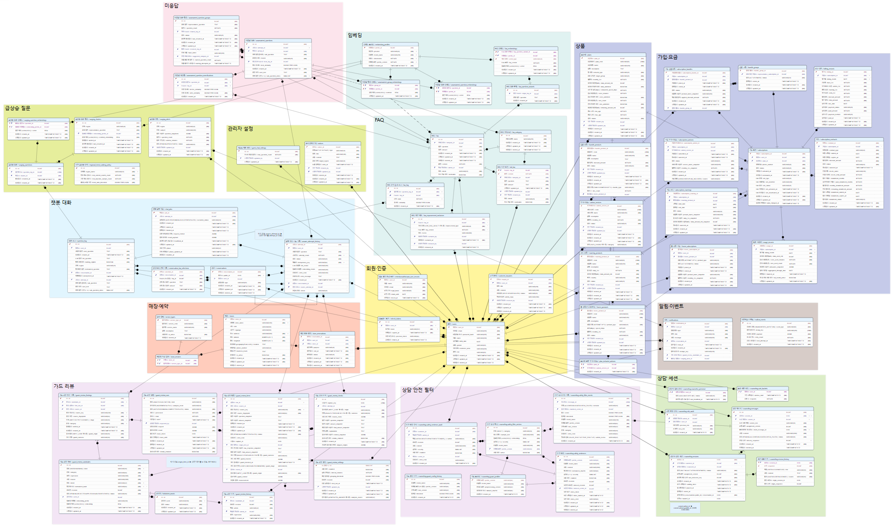

# 기능을 연결하는 데이터 구조

[제품 소개](../../profile/README.md) · [전체 기능](../README.md) · [시스템 구성](overview.md)

UBot은 회원·대화를 중심으로 상품과 가입 정보, FAQ 검색, 매장 예약, 상담사 상담을 연결합니다. 고객의 질문과 처리 결과를 남기고, 미응답·가드 검토·지역 문의 분석에서 다음 개선에 활용합니다.

## 전체 ERD

[원본 이미지 열기](../images/erd-full.png)

넓은 그림에서는 기능별 영역과 연결을 먼저 보고, 작은 컬럼명은 원본을 확대해 확인할 수 있습니다. 현재 스키마의 세부 내용은 [BE 마이그레이션](https://github.com/ureca-UBot/UBot-BE/tree/develop/src/main/resources/db/migration)에서 확인합니다.

## 색상별로 읽기

| 색상 | 파트 | 그림의 박스 | 맡는 데이터와 기능 |
|---|---|---|---|
| 연노랑 `#FFF59D` | 회원·인증 | 회원·인증 | 회원, 인증 갱신, 탈퇴 기록. 회원의 가입·예약·대화·상담과 관리자의 변경 이력을 연결합니다. |
| 하늘색 `#D6EEFB` | 챗봇 대화 | 챗봇 대화 | 대화, 질문, 답변 시도, 처리 작업, FAQ 선택 기록. 질문 접수부터 결과 저장과 이전 대화 조회까지 이어집니다. |
| 청록색 `#DDF1EE` | RAG 지식 | FAQ, 임베딩 | FAQ 원문·수정 이력·질문 표현과 검색 벡터. 임베딩 프로필을 함께 관리해 같은 조건의 자료를 검색합니다. |
| 분홍색 `#FBE1EA` | 미응답 개선 | 미응답 | 답하지 못한 질문, 유사 질문 묶음, FAQ 보완 후 재검증 기록. 검색에 부족한 지식을 개선합니다. |
| 연보라색 `#EDE0F3` | 안전·가드 | 가드 리뷰, 상담 안전 필터 | 챗봇 검사 결과와 정책 후보의 검토·승인 이력, 상담 금지 문장·벡터와 메시지 판정 기록을 관리합니다. |
| 연두색 `#E3F1D6` | 상담사 상담 | 상담 세션 | 상담 요청·배정·종료 상태, 상담사 접속 상태, 메시지와 인계 기록. 상담별 진행 상태와 저장 이력을 관리합니다. |
| 보라색 `#C9CDEC` | 통신 상품·가입 | 상품, 가입·요금 | 상품 카탈로그, 회선과 가입 상태, 약정·할부·사용량·청구, 로밍과 결합 구성. 상품 안내와 MY 조회에 사용합니다. |
| 살구색 `#FBCDB9` | 매장·예약 | 매장·예약 | 매장 위치·제공 서비스와 방문 예약. 지도 검색, 가능 시간 조회, 예약·취소를 지원합니다. |
| 황록색 `#E3E89A` | 운영·분석 | 급상승 질문, 관리자 설정 | 지역별 유사 문의 묶음과 급증 감지 기록, 순위 정책, 비회원 이용 설정 등. 관리자 판단과 운영에 사용합니다. |
| 회갈색 `#D9CEC8` | 알림·후속 작업 | 알림·이벤트 | 사용자에게 보여 줄 알림과 다시 처리할 후속 작업을 각각 저장합니다. Outbox는 미응답·FAQ 재검증·지역 문의 분석을 이어갑니다. |

## 고객의 행동이 데이터로 이어지는 흐름

### 질문에서 답변과 상담까지

고객이 질문하면 대화에 질문과 처리 작업을 연결합니다. FAQ 원문·질문 표현·벡터를 검색하고, 필요한 상품·본인 정보·매장 자료를 조회한 뒤 답변 결과를 저장합니다. 회원이 채팅 안에서 FAQ를 직접 선택한 경우도 선택 시점의 문답을 보존합니다.

회원이 상담사를 호출하면 현재 대화의 저장된 AI 문답·FAQ 선택 사본·허용된 이전 상담 기록을 자동으로 인계합니다. 상담사의 배정 상태와 메시지 판정을 관리하고, 종료 후에는 같은 대화에서 AI 질문과 FAQ 선택을 이어갈 수 있습니다. 재상담할 때는 그사이 추가한 기록도 서버에서 다시 조회합니다.

[AI 상담](chat-flow.md) · [회원과 대화 기록](../features/accounts-and-conversations.md) · [상담사 인계](../features/counselor-handoff.md)

### 미응답에서 다음 FAQ까지

답하지 못한 질문 중 수집 대상을 남기고 유사 질문끼리 묶습니다. 관리자는 반복되는 질문을 FAQ로 보완하고, 새 질문 표현의 벡터를 검색에 반영합니다. 재검증 기록으로 기존 미응답의 검색 결과가 개선됐는지 확인합니다.

지역 문의 분석은 같은 지역에서 유사 질문이 늘어나는지를 살피는 별도 흐름입니다. 감지 당시 질문과 건수를 보존하고, 관리자가 내용을 확인해 대응 상태를 정합니다.

[FAQ 개선과 문의 분석](../features/knowledge-improvement.md)

### 상품·가입과 매장 방문

상품 카탈로그와 고객의 가입 내역을 구분합니다. 본인 회선에 가입·약정·사용량·청구를 연결해 MY 화면과 인증된 정보 조회에서 사용합니다. 매장 데이터에는 위치와 제공 서비스를, 예약에는 방문 시간과 처리 상태를 남깁니다.

공지와 일대일 문의도 고객 지원 데이터입니다. 공지는 대상 지역·게시 기간을, 문의는 고객의 질문·관리자 답변·처리 상태를 관리합니다. 이 기능들은 전체 ERD의 큰 분류와 함께 [고객 지원 문서](../features/customer-support.md)에서 확인할 수 있습니다.

[상품·가입·이용 정보](../features/products-and-subscriptions.md) · [매장·예약](../features/stores-and-reservations.md)

## 구분해서 봐야 하는 관계

- **회원이 없는 대화도 있습니다.** 회원은 여러 업무 데이터가 참조하는 중심이지만, 비회원 대화도 저장합니다. 모든 테이블이 반드시 회원을 참조하는 구조는 아닙니다.
- **가드 실행과 가드 검토는 역할이 다릅니다.** 실시간 입력·답변 검사와 상담 메시지 보호가 판정을 수행하고, 가드 리뷰는 그 결과와 정책 후보를 검토·승인한 이력을 남깁니다.
- **알림 전체가 Outbox를 거치지는 않습니다.** 예약 완료·취소 알림과 납부·로밍·약정·사용량 리마인더는 알림 서비스와 스케줄러에서 만듭니다. Outbox는 미응답 저장, FAQ 재검증, 지역 문의 분석과 급증 주제 생성에 사용합니다.
- **지역 문의 급증은 장애 확정이 아닙니다.** 질문 증가를 감지한 기록과 관리자가 게시하는 장애 공지는 별도로 관리합니다.
- **영역의 색은 업무 분류입니다.** 같은 PostgreSQL에 저장한 데이터를 제품 기능별로 나눈 것이며, 색마다 별도 서버나 데이터베이스가 있다는 뜻은 아닙니다.

## 코드에서 확인한 근거

아래 연결은 2026-10-27에 확인한 BE `develop`의 `f782ec7c` 기준입니다.

- [회원·비회원 대화](https://github.com/ureca-UBot/UBot-BE/blob/f782ec7c72cc2af0631570e3b3e0d0a260072a25/src/main/resources/db/migration/V19__create_conversations_and_guest_chat_settings.sql)
- [FAQ 선택 기록과 상담 데이터](https://github.com/ureca-UBot/UBot-BE/blob/f782ec7c72cc2af0631570e3b3e0d0a260072a25/src/main/resources/db/migration/V39__integrate_counsel_domain.sql)
- [Outbox 작업 종류](https://github.com/ureca-UBot/UBot-BE/blob/f782ec7c72cc2af0631570e3b3e0d0a260072a25/src/main/java/com/ubot/outbox/OutboxEventType.java) · [후속 작업 처리](https://github.com/ureca-UBot/UBot-BE/blob/f782ec7c72cc2af0631570e3b3e0d0a260072a25/src/main/java/com/ubot/outbox/OutboxWorker.java)
- [알림 생성](https://github.com/ureca-UBot/UBot-BE/blob/f782ec7c72cc2af0631570e3b3e0d0a260072a25/src/main/java/com/ubot/notification/service/NotificationService.java) · [리마인더](https://github.com/ureca-UBot/UBot-BE/blob/f782ec7c72cc2af0631570e3b3e0d0a260072a25/src/main/java/com/ubot/notification/reminder/NotificationReminderScheduler.java)
- [공지](https://github.com/ureca-UBot/UBot-BE/blob/f782ec7c72cc2af0631570e3b3e0d0a260072a25/src/main/resources/db/migration/V27__create_notices_table.sql) · [일대일 문의](https://github.com/ureca-UBot/UBot-BE/blob/f782ec7c72cc2af0631570e3b3e0d0a260072a25/src/main/resources/db/migration/V38__create_customer_inquiries.sql) · [지역 문의 분석](https://github.com/ureca-UBot/UBot-BE/blob/f782ec7c72cc2af0631570e3b3e0d0a260072a25/src/main/resources/db/migration/V52__create_telemap_tables.sql)
