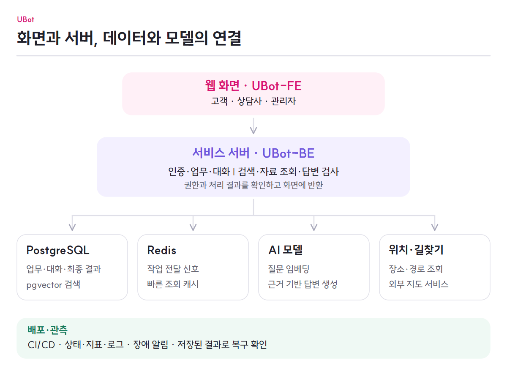

# UBot 시스템 구성

[전체 기능](../README.md) · [AI 상담 흐름](chat-flow.md) · [배포와 운영](../features/service-operations.md)

고객·상담사·관리자는 웹 화면에서 서비스를 이용합니다. 서버는 권한과 업무 조건을 확인하고, 데이터 저장소·모델·위치 서비스에서 필요한 자료를 받아 결과를 돌려줍니다.

<picture>
  <source media="(max-width: 767px)" srcset="../images/system-overview-mobile.png">
  
</picture>

[그림 크게 보기](../images/system-overview.png) · [모바일 그림](../images/system-overview-mobile.png)

## 구성 요소가 맡는 일

| 구성 요소 | 역할 | 관련 문서 |
|---|---|---|
| UBot-FE | 고객·상담사·관리자의 화면, 입력, 진행 상태와 결과 카드, 오류 안내 | [Frontend](https://github.com/ureca-UBot/UBot-FE) |
| UBot-BE | 인증·업무·대화 상태, FAQ 검색과 자료 조회, 모델·도구·안전 검사 연결, 결과 확정 | [Backend 기능 문서](https://github.com/ureca-UBot/UBot-BE/blob/f782ec7c72cc2af0631570e3b3e0d0a260072a25/docs/README.md) |
| PostgreSQL·pgvector | 업무·FAQ·벡터·대화·작업의 기준 데이터와 벡터 검색 | [DB 관리](https://github.com/ureca-UBot/UBot-BE/blob/f782ec7c72cc2af0631570e3b3e0d0a260072a25/docs/how-to/db-access.md) |
| Redis | 작업 전달 신호, 빠른 결과 조회와 순위 스냅샷, 보조 상태 | [작업 신뢰성](https://github.com/ureca-UBot/UBot-BE/blob/f782ec7c72cc2af0631570e3b3e0d0a260072a25/docs/reliability-model.md) |
| AI 모델 | 문장의 벡터 계산, 제공한 근거의 답변 생성, 경로별 안전 판정 | [모델 서빙](https://github.com/ureca-UBot/UBot-BE/blob/f782ec7c72cc2af0631570e3b3e0d0a260072a25/infra/llm/README.md) |
| 외부 위치 서비스 | 장소·좌표와 이동 경로 자료 제공 | [매장과 방문](../features/stores-and-reservations.md) |
| 배포·관측 구성 | 검증한 코드 배포, 지표·로그·알림, Worker 프로세스 복구와 작업 회수 | [서비스 운영](../features/service-operations.md) |

## 화면의 행동이 결과로 이어지는 방식

상품 가입이나 예약 요청은 서버가 로그인·소유권·업무 조건을 확인한 뒤 확정합니다. 화면은 서버 결과로 목록과 상태를 갱신합니다. 조회 자료가 부족하거나 요청이 거절되면 그 상태를 사용자에게 알립니다.

AI 상담은 질문을 먼저 접수하고 저장한 작업을 기준으로 진행합니다. 서버가 FAQ와 실제 조회 자료로 답변을 만들고 검사한 뒤 저장하면, 화면은 작업 조회로 답변과 카드를 표시합니다. [전체 채팅 흐름](chat-flow.md)에서 준비·검색·도구·가드·결과 표시를 이어서 설명합니다.

상담사 연결도 같은 대화의 서버 기록을 사용합니다. 고객 화면이 임의의 AI 문답을 만들어 인계하지 않으며, 상담 종료 뒤에는 저장한 통합 이력을 다시 조회합니다.

회원·대화·FAQ·상품·예약·상담이 어떤 데이터를 공유하는지는 [전체 ERD와 데이터 흐름](data-model.md)에서 설명합니다. 색상별 업무 영역과 함께 미응답 개선, 안전 검사, 사용자 알림과 후속 작업의 관계를 확인할 수 있습니다.

## 실행 역할과 자원 조절

질문 접수와 오래 걸리는 답변 처리는 같은 BE 코드의 서로 다른 실행 역할로 나눌 수 있습니다. 모델 실행은 별도의 계산 자원을 사용합니다. 업무 요청을 받는 용량과 모델 계산량에 맞춰 자원을 각각 조절할 수 있습니다.

DB가 최종 업무 상태와 작업 결과를 보존하고 Redis가 전달·캐시를 돕습니다. 프로세스 재시작이나 캐시 유실만으로 완료 여부를 판단하지 않으며, 저장한 상태를 다시 확인합니다.

AWS BE는 systemd 타이머로 배포 셸과 별개로 Worker 프로세스를 확인합니다. API 상태·배포 잠금·점검 중지 여부를 확인해 Worker를 기동한 뒤, Worker 내부 복구 루프가 저장 작업을 회수합니다.

## AWS 구성과 GPU 모드 전환

Terraform은 [스택별로 구분](https://github.com/ureca-UBot/UBot-BE/blob/f782ec7c72cc2af0631570e3b3e0d0a260072a25/infra/terraform/stacks.md)합니다. `gpu-test`는 개별 GPU 실험 서버를 준비하고, [aws-poc](https://github.com/ureca-UBot/UBot-BE/blob/f782ec7c72cc2af0631570e3b3e0d0a260072a25/infra/terraform/aws-poc.md)는 FE·BE·State와 NLB·GPU ASG를 구성합니다.

| 구성 | 동작과 조절 범위 | 구현 |
|---|---|---|
| BE EC2 | API와 Java Worker 실행. BE CD는 앱을 교체하며 GPU 대수는 Terraform·ASG에서 조절 | [배포 절차](https://github.com/ureca-UBot/UBot-BE/blob/f782ec7c72cc2af0631570e3b3e0d0a260072a25/docs/deploy.md) |
| 내부 NLB | 채팅 8000·임베딩 8001을 각각 GPU 대상 그룹으로 전달 | [nlb.tf](https://github.com/ureca-UBot/UBot-BE/blob/f782ec7c72cc2af0631570e3b3e0d0a260072a25/infra/terraform/aws-poc/nlb.tf) |
| Spot GPU ASG | Spot 인스턴스만 포함. ASG 내 평균 GPU 사용률 60%를 목표로 입력한 최소·최대 대수 사이에서 조절 | [gpu.tf](https://github.com/ureca-UBot/UBot-BE/blob/f782ec7c72cc2af0631570e3b3e0d0a260072a25/infra/terraform/aws-poc/gpu.tf) |
| 선택형 On-Demand GPU | ASG 밖의 단일 EC2. 평소 채팅·임베딩을 처리하고 관리자 분석 때 14B 모델로 전환 | [gpu_on_demand.tf](https://github.com/ureca-UBot/UBot-BE/blob/f782ec7c72cc2af0631570e3b3e0d0a260072a25/infra/terraform/aws-poc/gpu_on_demand.tf) |

On-Demand GPU의 [전환기](https://github.com/ureca-UBot/UBot-BE/blob/f782ec7c72cc2af0631570e3b3e0d0a260072a25/infra/guard-review-runtime/switcher.py)는 두 대상 그룹에 다른 정상 GPU가 있는지 확인한 뒤 NLB에서 자신을 제외하고 관리자 분석 모드로 전환합니다. 채팅·임베딩이 다시 준비되면 재등록합니다. 분석 중 재등록되는 일을 막기 위해 이 GPU의 NLB 등록은 전환기가 관리합니다.

[입력 예시](https://github.com/ureca-UBot/UBot-BE/blob/f782ec7c72cc2af0631570e3b3e0d0a260072a25/infra/terraform/aws-poc/terraform.tfvars.example)의 Spot 최소·최대 대수는 `0/0`이고, On-Demand GPU와 AMI 빌더의 [생성 기본값](https://github.com/ureca-UBot/UBot-BE/blob/f782ec7c72cc2af0631570e3b3e0d0a260072a25/infra/terraform/aws-poc/variables.tf)은 각각 `false`입니다. 실제 적용할 대수와 생성 여부는 환경별 입력 파일에서 정합니다.

## 실험과 구현의 연결

연구 저장소에서 생성 모델·임베딩·벡터 저장소를 비교하고, 제품 저장소가 선택한 구성을 실제 기능에 연결합니다. 실험 환경의 수치를 현재 제품 전체의 보장값으로 합치지 않습니다.

[UBot-ServerTest](https://github.com/ureca-UBot/UBot-ServerTest)에는 FE 진입 주소를 사용한 채팅 부하, 로컬 장애 복구, 알림 기록과 실제 관리자 화면 검증을 모았습니다. 각 실험의 이미지·설정·결과와 화면 캡처에서 구현이 연결된 범위를 확인할 수 있습니다.

[저장소 지도](components.md) · [기술 결정](decisions/README.md) · [실험과 검증 근거](../proof/evidence-register.md)
