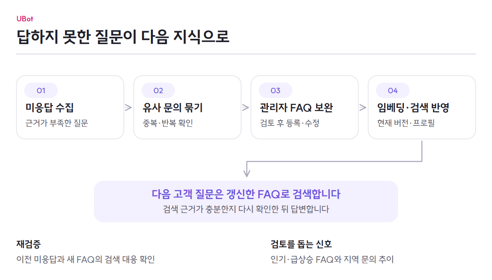

# 미응답에서 다음 FAQ까지

[전체 기능](../README.md) · [AI 상담](../architecture/chat-flow.md) · [안전 정책](ai-safety.md)

관리자는 공식 FAQ를 준비하고, 고객이 답을 받지 못한 질문과 문의 추이를 보면서 지식을 보완합니다. 검색·미응답·관리자 검토·재색인이 하나의 개선 흐름으로 이어집니다.

<picture>
  <source media="(max-width: 767px)" srcset="../images/knowledge-flow-mobile.png">
  
</picture>

## FAQ를 검색할 수 있게 준비합니다

관리자 화면에서 카테고리·질문·공식 답변·질문 표현·처리 의도를 등록합니다. 서버는 현재 FAQ 버전의 질문 표현을 임베딩하고 검색에 반영합니다. FAQ를 고치면 수정 전 이력과 현재 내용을 구분해 보존합니다.

삭제된 FAQ, 이전 버전의 벡터, 다른 임베딩 프로필의 벡터를 현재 검색 결과와 섞지 않습니다. 모델이나 프로필을 바꿨을 때는 백필 화면에서 새 벡터를 준비할 수 있습니다. 조건을 만족한 일반 FAQ는 등록된 답변을 직접 반환하도록 관리할 수 있습니다.

## 답하지 못한 질문을 개선합니다

| 단계 | 관리자 화면 | 서버 처리 |
|---|---|---|
| 수집 | 미응답 목록에서 반복 문의와 사유 확인 | 수집 대상 질문을 남기고 후속 작업으로 저장·임베딩 |
| 묶기 | 대표 질문·건수·상세 질문 확인 | 유사 질문 그룹화와 동일 시도·반복 재시도 중복 방지 |
| 검토 | 승인·보류·반려, FAQ 작성 | 상태와 입력을 확인하고 FAQ 전환 결과 저장 |
| 반영 | 변경 FAQ와 색인 결과 확인 | 현재 버전의 질문 벡터를 검색에 반영 |
| 재검증 | 이전 미응답과 새 FAQ의 대응 확인 | FAQ 변경 뒤 검색 유사도의 개선 여부 확인 |

시스템 장애나 가드의 거절을 모두 FAQ 부족으로 수집하지 않습니다. 재검증은 검색 대응 결과이며, 최종 답변의 정확도를 전체 재평가한 결과는 아닙니다. FAQ 작성과 승인은 관리자가 수행합니다.

## 인기 질문과 지역 문의를 함께 봅니다

인기·급상승 FAQ는 답변에 사용한 FAQ 기록을 집계해 고객 화면에 보여 줍니다. 집계 대상인 회원 기록과 순위 조회 권한은 다르므로 비회원도 공개 순위를 볼 수 있습니다.

지역 문의 분석은 같은 지역의 의미가 비슷한 질문이 늘어나는지 살펴봅니다. 서버가 감지 당시 질문과 건수를 남기고 관리자에게 알립니다. 관리자는 상세를 읽고 대응 완료로 표시할 수 있습니다. 통신망 자체를 측정하거나 감지 즉시 장애 공지를 등록하는 기능은 아닙니다.

FAQ 운영 화면에서는 사용 현황, 개선·제외 대상과 품질 검토 결과를 살펴볼 수 있습니다.

## 상세 구현과 검증

- Backend: [FAQ와 색인](https://github.com/ureca-UBot/UBot-BE/blob/98ba921c0e8271a8aa068a5bda56e85fe50c1ce7/docs/features/faq-management.md) · [미응답 개선](https://github.com/ureca-UBot/UBot-BE/blob/98ba921c0e8271a8aa068a5bda56e85fe50c1ce7/docs/features/unanswered-improvement.md) · [인기·지역 문의](https://github.com/ureca-UBot/UBot-BE/blob/98ba921c0e8271a8aa068a5bda56e85fe50c1ce7/docs/features/trends-and-telemap.md)
- Frontend: [FAQ 관리 문서](https://github.com/ureca-UBot/UBot-FE/blob/develop/docs/ADMIN_FAQ_WORK_SUMMARY.md) · [미응답 화면](https://github.com/ureca-UBot/UBot-FE/blob/develop/src/admin/pages/unanswered/UnansweredGroupListPage.tsx) · [지역 문의 화면](https://github.com/ureca-UBot/UBot-FE/blob/develop/src/admin/pages/telemap/TelemapPage.tsx)
- 선택 근거: [임베딩·검색·리랭커 실험](../proof/evidence-register.md#임베딩검색리랭커)
