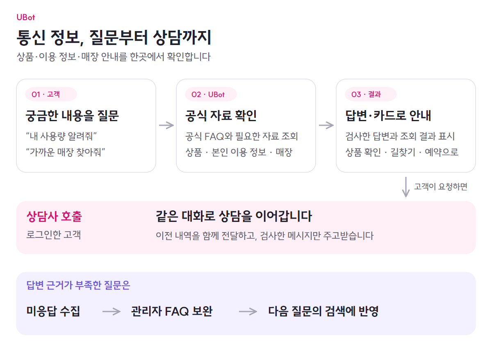

# UBot

**상품 탐색부터 이용 정보 확인, 매장 방문과 상담까지 이어지는 통신 생활 서비스**

어떤 상품을 쓸지, 이번 달 이용 내역은 어떤지, 어디에서 도움을 받을지 한곳에서 확인합니다. 메뉴에서 직접 찾거나 AI에게 물어보고, 사람의 도움이 필요하면 같은 대화에서 상담을 이어갑니다.

[서비스 이용하기](https://u-bot.cloud) · [시나리오로 살펴보기](../docs/overview/product.md) · [전체 기능 문서](../docs/README.md)

  <picture>
    <source media="(max-width: 767px)" srcset="../docs/images/product-guide-mobile.png">
    
  </picture>

[질문에서 답변까지](../docs/architecture/chat-flow.md) · [상담사에게 연결하기](../docs/features/counselor-handoff.md) · [미응답으로 FAQ 개선하기](../docs/features/knowledge-improvement.md)

## UBot에서 할 수 있는 일

| 기능 | 제공하는 경험 |
|---|---|
| [상품과 내 이용 정보](../docs/features/products-and-subscriptions.md) | 요금제·홈상품·부가서비스·로밍·결합상품을 살펴보고 가입을 관리합니다. 회선별 사용량·청구·약정도 확인합니다. |
| [매장 찾기와 방문 예약](../docs/features/stores-and-reservations.md) | 주변 매장을 지도에서 찾고 길찾기, 시간 선택, 예약과 취소까지 이어갑니다. |
| [근거 기반 AI 상담](../docs/architecture/chat-flow.md) | 공식 FAQ와 실제 조회 자료로 답을 받고, 상품·이용 정보·매장 카드를 함께 확인합니다. |
| [상담사 연결](../docs/features/counselor-handoff.md) | 같은 대화의 기록을 상담사에게 전달하고, 보호 검사를 거쳐 메시지를 주고받습니다. |
| [회원과 대화 기록](../docs/features/accounts-and-conversations.md) | 비회원으로 시작한 대화를 로그인 뒤 이어가고, 저장한 문답·FAQ 선택·상담 이력을 다시 봅니다. |
| [공지·문의·알림](../docs/features/customer-support.md) | 지역 공지와 장애 안내, 일대일 문의 답변, 예약·납부·이용 알림을 확인합니다. |
| [FAQ와 지식 개선](../docs/features/knowledge-improvement.md) | 관리자가 미응답을 검토해 FAQ를 보강하고 인기 질문과 지역 문의 급증을 살펴봅니다. |
| [질문·답변과 상담 보호](../docs/features/ai-safety.md) | 입력·생성 답변·상담 메시지를 검사하고, 관리자가 안전 정책 후보를 검토합니다. |
| [배포와 서비스 운영](../docs/features/service-operations.md) | 배포 결과와 서비스 상태를 확인하고, 장애 알림에서 진단·복구·결과 확인으로 이어갑니다. |

## 세 가지 흐름으로 살펴보기

### 고객: 질문에서 필요한 행동까지

“지금 쓰는 상품이 궁금해요”, “가까운 매장을 찾고 싶어요”처럼 질문하면 관련 FAQ를 찾고 필요한 자료를 조회합니다. 고객은 답변과 카드를 보고 상품이나 매장 화면으로 이동합니다. 상담사를 호출하면 앞선 문답과 FAQ 선택을 다시 설명할 필요 없이 상담을 이어갈 수 있습니다.

[AI가 근거를 찾아 답하는 과정](../docs/architecture/chat-flow.md) · [매장 방문 과정](../docs/features/stores-and-reservations.md) · [상담사에게 이어지는 과정](../docs/features/counselor-handoff.md)

### 관리자: 답하지 못한 질문에서 다음 지식까지

관리자는 비슷한 미응답을 묶어 보고, 반복되는 문의를 FAQ로 만듭니다. 바뀐 질문 표현은 다시 임베딩해 검색에 반영합니다. 인기·급상승 질문과 지역 문의 흐름을 함께 보면서 개선할 내용을 정합니다.

[미응답 수집부터 FAQ 검색 반영까지](../docs/features/knowledge-improvement.md) · [안전 정책 검토](../docs/features/ai-safety.md)

### 운영자: 배포에서 장애 대응까지

코드를 검증한 뒤 배포하고 서비스·데이터 저장소·모델의 상태를 확인합니다. 장애가 발생하면 알림과 로그로 원인을 찾고, 저장된 작업을 기준으로 복구 여부를 확인합니다. 공식 FAQ 직접 반환과 실행 역할 분리로 모델 호출과 자원 사용을 조절합니다.

[배포·관측·복구와 비용 판단](../docs/features/service-operations.md)

## 설계 판단과 검증 근거

| 제품에서 필요한 것 | 선택과 확인한 근거 |
|---|---|
| 질문에 맞는 공식 자료 검색 | 임베딩 모델·검색·리랭커 비교를 거쳐 검색 구성을 선택했습니다. [검색 실험](../docs/proof/evidence-register.md#임베딩검색리랭커) |
| 답변 품질과 실행 비용의 균형 | 고정된 근거를 제공한 생성 모델 평가와 GPU 서빙 실험을 따로 수행했습니다. [모델 평가](../docs/proof/evidence-register.md#생성-모델) |
| FAQ와 벡터의 일관된 관리 | 벡터 저장소 성능과 함께 원문·벡터·색인을 관리하는 운영 부담을 비교했습니다. [선택 근거](../docs/architecture/decisions/ADR-001-vector-database.md) |
| 장애 이후에도 확인할 수 있는 결과 | 실제 LLM 요청 중 처리 프로세스·Redis·DB·모델을 중단하고 복구를 검증했습니다. [장애 실험](https://github.com/ureca-UBot/UBot-BE/blob/98ba921c0e8271a8aa068a5bda56e85fe50c1ce7/docs/evidence/fault-recovery-20261023.md) |
| 기존 화면과 기능 유지 | 프론트엔드 구조를 정리하면서 빌드·논리 테스트·화면 비교를 기록했습니다. [회귀 기록](../docs/proof/evidence-register.md#프론트엔드-회귀-기록) |

실험별 데이터·모델·환경과 확인한 범위는 연결된 기록에 있습니다. UBot의 가입·청구 정보는 서비스 내부 데이터이며, 실제 통신사의 개통·과금 원장을 연동한 것은 아닙니다.

## 더 알아보기

[시스템 구성](../docs/architecture/overview.md) · [기술 결정](../docs/architecture/decisions/README.md) · [직접 실행하기](../docs/getting-started/quickstart.md)

| 저장소 | 담고 있는 내용 |
|---|---|
| [UBot-FE](https://github.com/ureca-UBot/UBot-FE) | 고객·상담사·관리자 웹 화면 |
| [UBot-BE](https://github.com/ureca-UBot/UBot-BE) | 회원·상품·매장·상담·관리자 업무, 검색·답변 처리와 운영 구성 |
| [UBot-LLMTest](https://github.com/ureca-UBot/UBot-LLMTest) | 생성 모델 품질·프롬프트·GPU 서빙 평가 |
| [UBot-EmbeddingTest](https://github.com/ureca-UBot/UBot-EmbeddingTest) | 임베딩·검색·리랭커와 서빙 비교 |
| [UBot-VertorDBTest](https://github.com/ureca-UBot/UBot-VertorDBTest) | 벡터 저장소와 인덱스 비교 |
