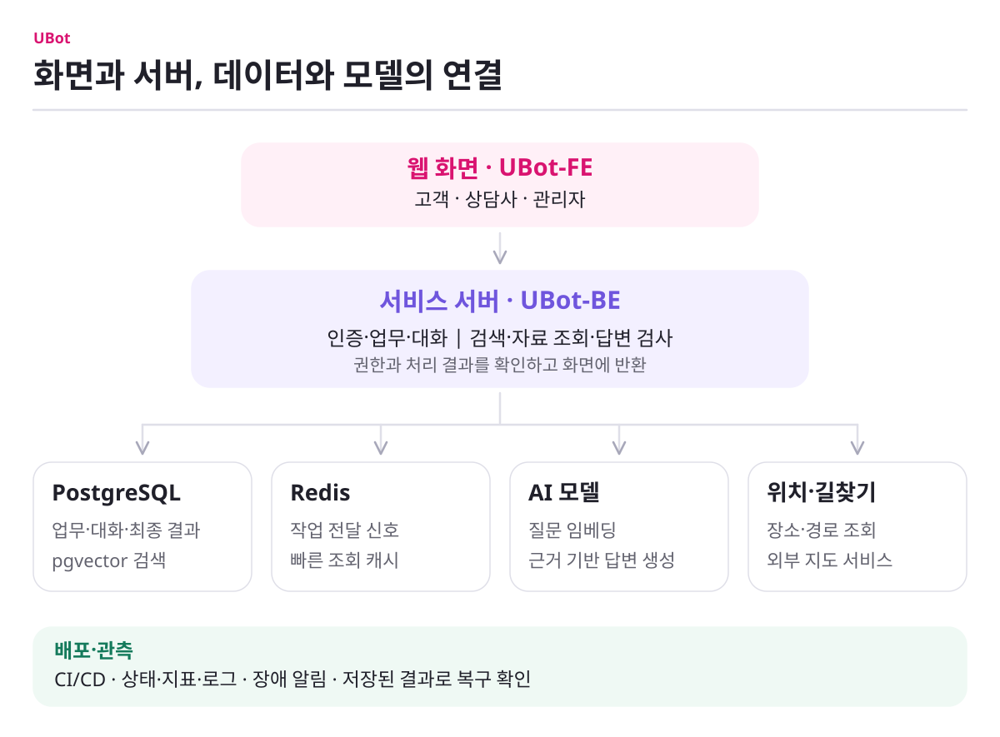

# UBot

> 공식 통신 정보에 근거한 AI 답변부터 사람 상담사 인계, 미응답 지식 개선, 운영 복구까지 하나의 대화 흐름으로 연결합니다.

UBot은 통신 상품과 이용 정보를 찾는 고객, 상담을 이어받는 상담사, 지식을 관리하는 운영자를 위한 AI 상담 서비스입니다. 고객 질문에는 공식 FAQ와 서버가 조회한 자료를 사용하고, AI가 해결하지 못한 질문은 상담과 FAQ 개선 흐름으로 이어집니다.

[서비스](https://u-bot.cloud) · [백엔드](https://github.com/ureca-UBot/UBot-BE) · [프론트엔드](https://github.com/ureca-UBot/UBot-FE) · [전체 문서](../docs/README.md)

## 하나로 이어지는 상담 흐름

1. 고객이 상품·이용 정보·매장에 관해 질문합니다.
2. Backend가 입력을 검사하고 FAQ와 필요한 서버 자료를 모읍니다.
3. AI가 받은 근거 안에서 답하고, 서버가 결과를 다시 검사합니다.
4. 해결되지 않으면 로그인한 고객은 같은 대화에서 상담사를 호출할 수 있습니다.
5. 상담사는 서버에 저장된 이전 문답과 선택한 FAQ를 넘겨받아 상담을 이어갑니다.
6. 미응답과 반복 문의는 관리자 검토와 FAQ 개선 대상으로 남습니다.

<picture>
  <source media="(max-width: 767px)" srcset="../docs/images/system-overview-mobile.svg">
  
</picture>

[그림 크게 보기](../docs/images/system-overview.svg) · [모바일 그림](../docs/images/system-overview-mobile.svg) · [시스템 구성 자세히 보기](../docs/system-architecture.md)

## 핵심 기능

- **근거 기반 AI 상담** — FAQ와 서버가 조회한 상품·고객·매장 정보를 바탕으로 답합니다.
- **사람 상담사 인계** — 브라우저가 만든 임의 내용이 아니라 서버 저장 기록으로 상담 맥락을 구성합니다.
- **지식 개선 루프** — 근거가 부족한 질문을 미응답으로 모아 FAQ 보강으로 연결합니다.
- **업무 흐름 연결** — 상품 탐색·가입, 이용 정보, 매장 검색·길찾기·예약, 공지·문의·알림을 제공합니다.
- **운영 가능한 비동기 처리** — API와 AI Worker를 분리하고 저장된 작업 상태를 기준으로 장애 뒤 처리를 복구합니다.
- **경로별 안전 검사** — 일반 질문, 생성 답변과 사람 상담 메시지의 성격에 맞는 검사 경로를 둡니다.
- **관측과 장애 대응** — API·Worker·DB·Redis·모델을 나눠 관찰하고 각 장애에 맞는 복구 절차로 연결합니다.

## Start Here

| 알고 싶은 내용 | 문서 |
|---|---|
| UBot이 누구의 어떤 문제를 해결하는가 | [Product Overview](../docs/product-overview.md) |
| FE·BE·AI·DB가 어떻게 연결되는가 | [System Architecture](../docs/system-architecture.md) |
| 어떤 Repository가 무엇을 책임지는가 | [Repository Map](../docs/repository-map.md) |
| 왜 모델·임베딩·Vector DB와 비동기 구조를 선택했는가 | [Engineering Decisions](../docs/engineering-decisions.md) |
| 실험 수치가 무엇을 검증했고 어디까지 해석할 수 있는가 | [Evidence Register](../docs/evidence-register.md) |
| 공통 용어와 문서 작성 규칙 | [Glossary](../docs/glossary.md) · [Documentation Policy](../docs/documentation-policy.md) |

## Repositories

### Production

- [UBot-BE](https://github.com/ureca-UBot/UBot-BE) — 백엔드, AI 처리 조정, 데이터와 운영
- [UBot-FE](https://github.com/ureca-UBot/UBot-FE) — 고객·상담사·관리자 웹 애플리케이션

### Research and Benchmark

- [UBot-LLMTest](https://github.com/ureca-UBot/UBot-LLMTest) — LLM 품질·프롬프트·GPU 서빙 평가
- [UBot-EmbeddingTest](https://github.com/ureca-UBot/UBot-EmbeddingTest) — 임베딩·검색 구조·리랭커 평가
- [UBot-VertorDBTest](https://github.com/ureca-UBot/UBot-VertorDBTest) — Vector DB와 인덱스 비교

연구 결과는 기술 선택의 근거입니다. 서로 다른 데이터·모델·런타임의 수치를 합쳐 현재 제품 성능으로 표현하지 않습니다. 실험과 Production 구현의 연결은 [Engineering Decisions](../docs/engineering-decisions.md)에서 확인합니다.

## 현재 범위

- UBot은 통신사의 과금·개통 원장을 대체하지 않습니다.
- 모델이 사용자의 권한이나 가입·예약 상태를 임의로 확정하지 않습니다. 상태 변경과 소유권 판단은 Backend가 담당합니다.
- Research Repository의 최고 수치는 Production 보장값이 아닙니다.
- API, 환경변수, 임계값, 제한 시간, 재시도와 데이터베이스 제약은 해당 Repository 문서를 기준으로 확인합니다.
