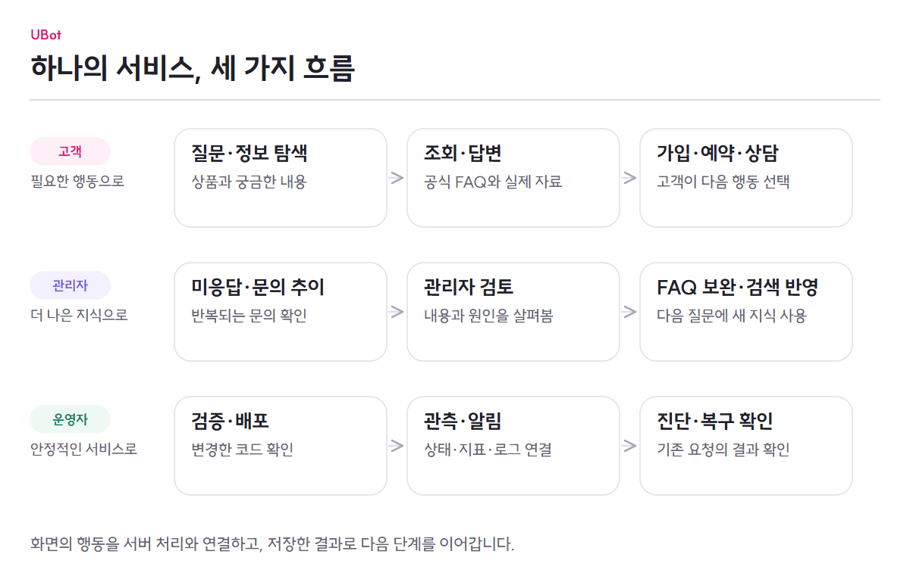

# UBot

**상품 탐색·가입 관리부터 이용 정보 조회, 매장 예약, AI 상담과 상담사 연결까지 이어지는 통신 생활 서비스**

UBot은 고객이 통신 상품을 찾고, 본인의 이용 내역을 확인하고, 필요한 도움을 받을 수 있는 웹 서비스입니다. 상품·MY·매장·고객센터 화면에서 직접 업무를 처리하거나, AI에게 질문해 공식 안내와 조회 자료를 확인할 수 있습니다.

고객 화면과 함께 **상담사 업무 화면, 관리자 화면, 서비스 운영 환경**을 구현했습니다. 상담사는 앞선 대화를 이어받고, 관리자는 상품·매장·문의·FAQ를 관리하며, 운영자는 배포부터 상태 확인·장애 대응까지 이어갑니다.

[서비스 이용하기](https://u-bot.cloud) · [전체 기능 문서](../docs/README.md) · [시스템 구성](../docs/architecture/overview.md) · [실험과 검증 근거](../docs/proof/evidence-register.md)

## 무엇을 구현했나요?

| 영역 | 구현한 기능 |
|---|---|
| **상품 탐색과 가입 관리** | 요금제·인터넷·IPTV·부가서비스·로밍·결합상품 조회, 가입·변경·해지, 로밍 일정과 결합 구성원 관리. [상세 동작](../docs/features/products-and-subscriptions.md) |
| **내 이용 정보** | 본인 회선 선택, 가입 상품·약정·할부·사용량·청구 내역 조회. AI 상담에서도 권한을 확인한 본인 자료를 안내에 사용합니다. [상세 동작](../docs/features/products-and-subscriptions.md) |
| **매장 찾기와 방문 예약** | 주소·지역·현재 위치·지도 범위 검색, 이동 방식별 길찾기, 가능 시간 조회, 예약·취소·방문 상태 관리. [상세 동작](../docs/features/stores-and-reservations.md) |
| **공지·문의·알림** | 지역·기간별 공지와 장애 배너, 일대일 문의·관리자 답변, 예약·납부·로밍·약정·사용량 알림과 읽음 처리. [상세 동작](../docs/features/customer-support.md) |
| **회원·비회원과 대화 기록** | 로그인과 역할별 접근, 비회원 질문과 이용 한도, 로그인 후 대화 승계, 이전 문답·FAQ 선택·상담 이력 조회. [상세 동작](../docs/features/accounts-and-conversations.md) |
| **근거 기반 AI 상담** | 여러 질문과 후속 질문 처리, FAQ 임베딩·검색, 상품·본인 정보·매장 조회 도구, 답변·결과 카드, 평가·의도별 재검색·취소. [전체 처리 흐름](../docs/architecture/chat-flow.md) |
| **상담사 연결과 보호** | 같은 대화에서 요청·대기·배정·상담·종료·재상담. 서버에 저장한 이전 내역을 인계하고, 금지어·의미 검사를 통과한 메시지만 전달합니다. [상세 동작](../docs/features/counselor-handoff.md) |
| **관리자 업무 화면** | 상품·매장·예약·공지·문의의 조회와 처리, FAQ·카테고리·질문 표현 관리, 수정 이력과 임베딩 백필. [상품](../docs/features/products-and-subscriptions.md) · [매장](../docs/features/stores-and-reservations.md) · [고객 지원](../docs/features/customer-support.md) · [FAQ](../docs/features/knowledge-improvement.md) |
| **미응답과 FAQ 개선** | 근거가 부족한 질문 수집, 유사 질문 그룹화, 관리자 검토와 FAQ 전환, 재색인. FAQ 수정 후 기존 미응답을 다시 검색해 개선 여부를 확인합니다. [상세 동작](../docs/features/knowledge-improvement.md) |
| **문의 추이와 지역 분석** | 인기·급상승 FAQ, 지역별 유사 문의 급증 감지, 당시 질문·건수 확인과 관리자 대응 상태 관리. [상세 동작](../docs/features/knowledge-improvement.md#인기-질문과-지역-문의를-함께-봅니다) |
| **질문·답변의 안전 검사** | 입력 공격·위험 표현 검사, 생성 답변의 근거·수치·정책 검사, 금지어 후보의 오차단·회귀 검토와 관리자 승인. [상세 동작](../docs/features/ai-safety.md) |
| **배포·관측·장애 대응** | 서비스 코드 CI/CD, AWS·Terraform 구성, 운영 화면·지표·로그·알림, 장애별 대응 절차와 저장된 작업의 복구. [상세 동작](../docs/features/service-operations.md) |

## 기능을 하나의 서비스로 연결했습니다

### 고객은 상품을 찾고, 이용하고, 도움을 받습니다

상품을 살펴본 고객이 가입을 요청하면 서버가 본인 회선과 업무 조건을 확인합니다. MY 화면에서는 가입 상품과 이용 내역을 확인합니다. 방문이 필요하면 지도에서 매장을 찾아 시간을 예약하고, 예약 내역과 알림을 다시 확인합니다.

궁금한 내용은 AI에게 물어볼 수 있습니다. UBot은 공식 FAQ와 필요한 업무 자료를 찾아 답변하고, 조회한 내용을 카드로 보여 줍니다. 사람이 도와야 할 때는 로그인한 고객이 상담사를 호출합니다. 상담사는 앞선 문답과 FAQ 선택을 읽고 상담을 이어가며, 고객은 종료한 상담도 기존 대화 목록에서 다시 볼 수 있습니다.

[상품·이용 정보](../docs/features/products-and-subscriptions.md) · [매장 방문](../docs/features/stores-and-reservations.md) · [AI·상담 연결 그림](../docs/images/product-guide.png)

### 관리자는 업무를 처리하고, 반복되는 문의를 줄일 지식을 보완합니다

관리자는 상품·매장·공지 정보를 관리하고 예약과 일대일 문의를 처리합니다. FAQ의 공식 답변·질문 표현·카테고리를 관리하며 수정 전 이력도 확인합니다.

답하지 못한 질문은 비슷한 문의끼리 묶어 검토합니다. 관리자가 FAQ를 보완하면 새 질문 표현을 임베딩해 다음 검색에 반영합니다. 인기·급상승 FAQ와 지역 문의 급증도 개선할 내용을 정하는 데 활용합니다. 지역 문의 증가가 실제 장애인지는 관리자가 판단하며, 공지를 자동으로 게시하지는 않습니다.

[고객 지원 업무](../docs/features/customer-support.md) · [지식 개선과 문의 분석](../docs/features/knowledge-improvement.md) · [안전 정책 검토](../docs/features/ai-safety.md)

### 운영자는 배포부터 장애 이후의 결과까지 확인합니다

서비스 코드의 빌드·테스트가 끝나면 설정한 배포 경로를 통해 반영하고 상태를 확인합니다. 운영 화면과 지표·로그·알림으로 API·데이터 저장소·모델의 문제를 구분하고, 장애별 절차에 따라 조치합니다.

처리 중인 요청은 DB에 남겨 프로세스나 의존 서비스가 복구된 뒤 다시 확인할 수 있게 했습니다. 복구 여부는 서버가 다시 켜졌는지뿐 아니라, 기존 요청의 답변이 저장됐는지와 유실·중복·실패가 있는지까지 확인합니다.

[배포·관측·장애 대응](../docs/features/service-operations.md)

<picture>
  <source media="(max-width: 767px)" srcset="../docs/images/product-flow-mobile.png">
  
</picture>

## 이 기능들을 위해 선택한 구조

| 설계 판단 | 제품에 반영한 방식 |
|---|---|
| **공식 근거와 실제 자료로 안내** | FAQ를 검색하고 필요한 업무 자료를 조회합니다. 근거가 부족하면 답변을 보류하고, 생성 결과의 형식·근거·수치·위험 표현을 검사합니다. [검색과 답변](../docs/architecture/chat-flow.md) |
| **업무 확정은 서버에서 처리** | 모델에는 허용한 조회 도구만 제공합니다. 가입·변경·예약은 인증·소유권·업무 조건을 검사하는 별도 요청으로 확정합니다. [상품·가입 처리](../docs/features/products-and-subscriptions.md) |
| **이전 대화를 보존하는 상담** | 화면이 만든 본문 대신 서버의 AI 문답·FAQ 사본·허용된 상담 기록으로 인계합니다. 새로고침·재로그인·재상담에도 저장 기록을 사용합니다. [대화와 인계](../docs/features/counselor-handoff.md) |
| **검색 데이터의 일관된 관리** | PostgreSQL·pgvector에서 FAQ와 벡터를 함께 관리하고, 현재 FAQ 버전과 같은 임베딩 프로필의 자료를 검색합니다. [벡터 저장소 선택](../docs/architecture/decisions/ADR-001-vector-database.md) |
| **호출량과 자원을 함께 조절** | 조건에 맞는 공식 FAQ는 직접 반환해 생성 호출을 줄입니다. API·답변 처리·모델 실행을 나눠 필요한 자원을 조절합니다. [운영과 비용 판단](../docs/features/service-operations.md#비용을-판단하는-세-가지-지점) |

Frontend는 React·TypeScript, Backend는 Java·Spring으로 구현했습니다. PostgreSQL·pgvector·PostGIS와 Redis를 사용하며, BGE-M3 임베딩과 Qwen3-4B Instruct 계열의 답변 모델을 연결합니다. 배포·인프라는 GitHub Actions·Docker·AWS·Terraform, 관측은 Prometheus·Alertmanager 등을 사용합니다. 구성 요소 사이의 관계는 [시스템 구성](../docs/architecture/overview.md)에서 확인할 수 있습니다.

## 무엇을 비교하고 검증했나요?

| 검증 대상 | 수행한 내용과 결과 | 근거 |
|---|---|---|
| **검색과 모델 선택** | 임베딩 모델·리랭커·벡터 저장소, 생성 모델·양자화·프롬프트를 비교했습니다. 검색 품질, 답변 품질과 운영 부담을 함께 보고 현재 구성을 정했습니다. | [실험 전체](../docs/proof/evidence-register.md) · [기술 결정](../docs/architecture/decisions/README.md) |
| **검색 인덱스** | 1만 개의 합성 벡터를 사용한 BE 측정에서 HNSW 검색의 p50이 exact 검색보다 4.64~6.19배 빨랐습니다. 실제 FAQ 질문의 recall 평가는 별도입니다. | [HNSW 측정](https://github.com/ureca-UBot/UBot-BE/blob/98ba921c0e8271a8aa068a5bda56e85fe50c1ce7/docs/FAQ_HNSW_검색_테스트_보고서.md) |
| **임베딩 서빙** | 총 2,560건의 단기 비교에서 실패는 없었습니다. 동시성 32에서 vLLM의 요청 처리량은 질문 묶음별로 Ollama의 2.98~3.73배였습니다. | [조건과 해석 범위](../docs/proof/evidence-register.md#임베딩검색리랭커) |
| **실제 LLM 장애 복구** | 로컬에서 처리 프로세스·Redis·PostgreSQL·vLLM을 각각 100건 처리 중 중단했습니다. 총 400건의 최종 답변을 저장했고 유실·중복 저장·최종 실패·작업 타임아웃은 0건이었습니다. | [4종 장애 결과](https://github.com/ureca-UBot/UBot-BE/blob/98ba921c0e8271a8aa068a5bda56e85fe50c1ce7/docs/evidence/fault-recovery-20261023.md) |
| **화면 회귀** | FE 리팩터링 당시 데스크톱·모바일 49개 화면을 비교했습니다. 48개는 픽셀 차이가 없었고, 1개 화면의 관리자 날짜 영역에 차이가 있었습니다. | [검증 조건과 기록](../docs/proof/evidence-register.md#프론트엔드-회귀-기록) |

위 수치는 각 기록의 코드·데이터·모델·장비에서 얻은 결과입니다. 단기 구성 요소 실험과 고정 응답 화면 비교를 현재 운영 전체의 성능·정확도 보장으로 확대하지 않습니다.

## 구현 범위

- 상품 가입·청구·사용량은 UBot 내부 데이터로 처리합니다. 실제 통신사의 개통·과금 원장이나 결제 승인을 연동하지는 않습니다.
- AI는 등록한 FAQ와 조회할 수 있는 업무 자료를 바탕으로 안내합니다. 모든 질문에 답하는 범용 서비스는 아닙니다.
- Terraform의 구성 정의와 현재 실행 중인 클라우드 자원은 구분합니다. 자동 확장 가동 여부와 실제 운영 비용은 배포 환경에서 확인해야 합니다.

## 저장소와 상세 문서

| 저장소 | 확인할 내용 |
|---|---|
| [UBot-FE](https://github.com/ureca-UBot/UBot-FE) | 고객·상담사·관리자 화면과 API 연동, 브라우저 상태·오류 처리 |
| [UBot-BE](https://github.com/ureca-UBot/UBot-BE) | 업무 규칙·데이터·검색·답변·상담 처리, 배포와 운영 구성 |
| [UBot-LLMTest](https://github.com/ureca-UBot/UBot-LLMTest) | 생성 모델 품질·프롬프트·양자화·GPU 서빙 평가 |
| [UBot-EmbeddingTest](https://github.com/ureca-UBot/UBot-EmbeddingTest) | 임베딩·검색·리랭커와 서빙 비교 |
| [UBot-VertorDBTest](https://github.com/ureca-UBot/UBot-VertorDBTest) | 벡터 저장소·인덱스 비교와 선택 근거 |

[기능별 설명과 FE·BE 연결](../docs/README.md) · [제품 시나리오](../docs/overview/product.md) · [직접 실행하기](../docs/getting-started/quickstart.md)
